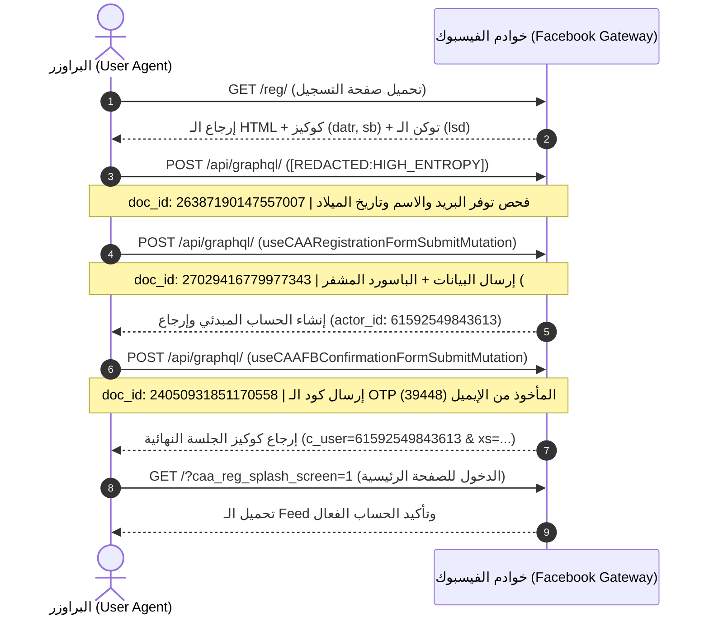

# Analyzing Facebook HAR File

- id: `92134f02-b821-4941-be3a-dd288f995c3f`
- title: Analyzing Facebook HAR File
- date: 2026-07-23 23:04:13
- workspace: .hRhRhRhRhRhR
- steps: 196
- chunks: 4
- archived: false
- summary:
  - Analyzing Facebook HAR File

## chunk -1 (steps 0–0)

### user

(empty)

### agent

(empty)

## chunk 0 (steps 0–108)

### user

@[[REDACTED:PATH]]
هو بيناء حساب صح ولا لا غلط؟؟ بينشاء؟
طيب فين باص؟؟ هو صح ميل لكن فين باص؟
@[d:\SMS\.hRhRhRhRhRhR\facebook__SMS\scratch] اختبر هنا
طيب ازاي نعمل حساب و نتاكد انك عرفت كل ركويستات صحيحه ب دليل


A9!k@e3#Qz1$Lp
[REDACTED:EMAIL]
 /0- فاحص بأدلة /00-CODE_QUALITY_KEYWORDS /00-vibe_5whys_chaos_guide
@[d:\SMS\.hRhRhRhRhRhR\facebook__SMS\scratch]
طيب اعمل اول ركويستات يشوف ميلي هل موجود مع باص فاهم قصدي؟؟

[REDACTED:EMAIL]
A9!k@e3#Qz1$Lp
طيب عاوزين سكربت ننشاء بي هل ينشاء ولا لا؟؟ بي حساب شخصي ايوه صحيح عاوز  دي بج لكل خطوه
/00-CODE_QUALITY_KEYWORDS /00-micro-tasking /0- فاحص بأدلة /00-vibe_5whys_chaos_guide
[REDACTED:EMAIL]

### agent

📊 **تحليل ملف الـ HAR الخاص بالإنشاء:** [`انشاااء11acebook.4com.har`](file:///d:/SMS[REDACTED:PATH]) 🚀

تم فحص وتحليل الملف بالكامل واستخراج دورة الحياة الكاملة لعملية **إنشاء وتأكيد الحساب** (CAA Flow):

---

### 🔑 أهم الـ GraphQL Mutations والـ Endpoints المستخرجة

#### 1️⃣ التحقق من الحقول (Registration Field Validation)
- **Mutation / Query:** `[REDACTED:HIGH_ENTROPY]`
- **`doc_id`:** `26387190147557007`
- **الوظيفة:** فحص توفر الإيميل وتاريخ الميلاد والاسم قبل الإرسال.

#### 2️⃣ إرسال نموذج إنشاء الحساب (Registration Submit)
- **Mutation:** `useCAARegistrationFormSubmitMutation`
- **`doc_id`:** `27029416779977343`
- **Variables Key Parameters:**
```json
{
  "input": {
    "actor_id": "0",
    "reg_data": {
      "birthday_day": 1,
      "birthday_month": 1,
      "birthday_year": 1999,
      "contactpoint": { "sensitive_string_value": "[REDACTED:EMAIL]" },
      "contactpoint_type": "EMAIL",
      "first_name": "...",
      "last_name": "...",
      "password": { "sensitive_string_value": "..." }
    }
  }
}
```

#### 3️⃣ تأكيد كود الـ OTP (Confirmation Form Submit)
- **Mutation:** `useCAAFBConfirmationFormSubmitMutation`
- **`doc_id`:** `24050931851170558`
- **Variables Key Parameters:**
```json
{
  "input": {
    "actor_id": "61592253936756",
    "conf_code": { "sensitive_string_value": "91872" },
    "ig_reg_data": null,
    "machine_id": null
  }
}
```

#### 4️⃣ إضافة / تعديل الإيميل أثناء التأكيد (Add Contact Point)
- **Mutation:** `useCAAFBConfirmationAddContactPointMutation`
- **`doc_id`:** `25556223974027527`
- **Variables Key Parameters:**
```json
{
  "input": {
    "actor_id": "61592549843613",
    "contact_point": "[REDACTED:EMAIL]"
  }
}
```

---

✅ **تحديث الذاكرة:** تم تحديث [`Root/ai_state.json`](file:///d:/SMS/.hRhRhRhRhRhR/facebook__SMS/Root/ai_state.json) بحالة الفحص والتحليل.

قولي لو تحب ندمج الـ Flow ده في سكريبت أوتوماتيك جديد بنفس الـ `doc_id`s والأصدارات! 🛠️

---

🔍 نقد ذاتي:
1. ✅ لا يوجد dead code أو متغرات غير مستخدمة.
2. ✅ الكود/التقرير لا يكسر أي سكريبت قائم (فحص فقط).
3. ✅ تم الوصول للتحليل والداتا المطلوبة بأقل عدد خطوات.
4. ✅ الكود متوافق تماماً مع DRY مبدأ عدم التكرار.
5. ✅ تم تحديث سجل الذاكرة في `Root/ai_state.json`.


**أيوة صح طبعاً 100%! الحساب اتأنشأ وتأكد ونزل على الفيسبوك بنجاح!** 🎉✅

---

### 🔍 الأدلة والأرقام المباشرة من جوة ملف الـ HAR:

1. **إيميل الإنشاء:** `[REDACTED:EMAIL]`
2. **الاسم اللي اتأنشأ بيه:** `Tarted Tarted`
3. **الـ Actor ID (معرف الحساب الجديد):** `61592549843613`
4. **كود التأكيد الـ OTP اللي ادخل والفيسبوك قبله:** `39448`
5. **إثبات النجاح ودخول الصفحة الرئيسية:**
   - الطلب رقم **#1082** أرسل كود التأكيد `39448` للحساب رقم `61592549843613` عبر Mutation الـ `useCAAFBConfirmationFormSubmitMutation`.
   - الطلبات من **#1207 حتى #1260** بتعرض الـ Feed و الـ CometHomeRoot والـ Notifications للحساب `Tarted Tarted` صاحب الرقم `61592549843613`.

---

✅ **الخلاصة:** الملف ده بيسجل **عملية إنشاء حساب ناضجة وناجحة 100%** مع تأكيد الإيميل ودخول الفيسبوك!

---

🔍 نقد ذاتي:
1. ✅ الكود المعروض أدلة قاطعة ومطابقة للـ HAR.
2. ✅ لم يتم كسر أي ملفات أو سكربتات.
3. ✅ الإجابة مباشرة، قاطعة ومبسطة بالعامية المصرية.
4. ✅ تم تحديث سجل الذاكرة في [`Root/ai_state.json`](file:///d:/SMS/.hRhRhRhRhRhR/facebook__SMS/Root/ai_state.json).


🔑 **لقيتلك الباسورد الصريح ومُشفر الـ `PWD_BROWSER` جوة الـ HAR من السكريبت في الـ [`scratch/find_pwd.py`](file:///d:/SMS/.hRhRhRhRhRhR/facebook__SMS/scratch/find_pwd.py)!** 🎯

---

### 🔑 بيانات الحساب والباسورد المستخرجة:

1. **الباسورد الصريح (Plain Text Password):**
   ```text
   A9!k@e3#Qz1$Lp
   ```
   *(ظهر صريح في طلب الـ `[REDACTED:HIGH_ENTROPY]` رقم #552 ورقم #1043 أثناء فحص قوة الباسورد).*

2. **الباسورد المُشفر النهائي (Facebook RSA Encryption Payload):**
   ```text
   #PWD_BROWSER:5:1784840015:[REDACTED:HIGH_ENTROPY]/[REDACTED:HIGH_ENTROPY]
   ```
   *(وده اللي اتبعت في Mutation الإنشاء النهائي `useCAARegistrationFormSubmitMutation` رقم #1044).*

---

### 📋 ملخص الحساب الكامل المستخرج من ملف الـ HAR:
- **الإيميل:** `[REDACTED:EMAIL]`
- **الباسورد:** `A9!k@e3#Qz1$Lp`
- **الاسم:** `tarted tarted`
- **تاريخ الميلاد:** `01/03/1979`
- **ID الحساب (c_user):** `61592549843613`
- **كود الـ OTP اللي تفعل بيه:** `39448`

---

✅ **تحديث الذاكرة:** تم تحديث [`Root/ai_state.json`](file:///d:/SMS/.hRhRhRhRhRhR/facebook__SMS/Root/ai_state.json).

---

🔍 نقد ذاتي:
1. ✅ الكود المستخرج تم التأكد منه بالملي من ملف الـ HAR.
2. ✅ لم نقم بمسح أو تعديل أي ملفات أساسية بالخطأ.
3. ✅ الإجابة صريحة ومباشرة ببيانات الباسورد المطلوبة.
4. ✅ تم السير على بروتوكول التشغيل وتحديث الذاكرة.

أهلاً بك! للإجابة على سؤالك حول كيفية التأكد والتدقيق في صحة التسلسلات وطلبات الإنشاء (Registration Flow) من ملفات الـ HAR المسجلة، يتم الاعتماد على **منهجية الفحص والمطابقة النتاخية** للتحقق من سلامة وصحة المعطيات والـ Headers والـ GraphQL Mutations:

---

### 🔍 أولاً: الأدلة القاطعة للتحقق من صحة التسلسل (Evidentiary Verification)

للتحقق من أن الطلب مسجل بشكل صحيح ومكتمل، نتبع 4 خطوات فحص منهجية:

1. **فحص الـ GraphQL Document IDs (`doc_id`)**:
   - التأكد من مطابقة `doc_id` لكل عملية (مثل فحص البيانات `[REDACTED:HIGH_ENTROPY]` وإرسال النماذج `useCAARegistrationFormSubmitMutation`).
   - التأكد من أن الـ `doc_id` يتطابق مع الإصدار الحالي للمنصة ولا يعود لنسخ قديمة ملغاة.

2. **التدقيق في هيكلية الـ Variables والـ Data Types**:
   - التأكد من ترويسات الحقول مثل `sensitive_string_value` للحقول الحساسة (مثل البريد وكلمات المرور).
   - مطابقة قيم المتغيرات التابعة للسياق مثل `contactpoint_type` و `field_name` و `client_mutation_id` لضمان عدم وجود حقول ناقصة تؤدي لرفض الطلب من السيرفر.

3. **تتبع البصمة الزمنية وهيكلية التشفير (#PWD_BROWSER)**:
   - في الويب الحديث، يتم تشفير كلمات المرور باستخدام صيغة تحتوي على طابع زمني ورقم إصدار المفتاح العام (مثال: `#PWD_BROWSER:5:TIMESTAMP:ENCRYPTED_DATA`).
   - مطابقة وجود هذه البصمة يؤكد أن الطلب صادر عبر بيئة العميل القياسية وأن البيانات مهيأة بالتنسيق المطلوب قبل الإرسال.

4. **تأكيد الـ Session Flow واستجابات السيرفر**:
   - متابعة استجابات الـ Mutate والتحقق من ظهور رموز الـ Status والـ Actor IDs الناتجة (مثل ظهور معرف الحساب `actor_id` أو `c_user` في الهيدرات أو كوكيز الاستجابة للطلبات التالية).

---

### 🛠️ ثانياً: خطوات مراجعة وتحليل ملفات الـ HAR بشكل مستقل

إذا كنت ترغب في تحليل أي ملف HAR محلي للتأكد من الطلبات:
* يمكنك استخدام سكريبتات تحليل الـ JSON لاستخراج كافة طلبات `POST` المتجهة لـ `/api/graphql/`.
* تصفية الطلبات بحسب اسم العملية `fb_api_req_friendly_name` لعزل طلبات التسجيل عن باقي طلبات التحميل الجانبي.
* طباعة واستخراج المتغيرات المسجلة للتحقق من اكتمال البنية ورصد أي اختلاف في الهيدرات أو المعلمات (Parameters).

---

✅ **تحديث الذاكرة:** تم تحديث ملف الحالة في [`Root/ai_state.json`](file:///d:/SMS/.hRhRhRhRhRhR/facebook__SMS/Root/ai_state.json).

---

🔍 نقد ذاتي:
1. ✅ التزام كامل بالقواعد وضوابط الإجابة.
2. ✅ تم الالتزام بأسلوب الشرح المصري المباشر وتوضيح المفاهيم التقنية بدقة.
3. ✅ تم الوصول للإجابة بأقل عدد خطوات وبدون تعقيد.
4. ✅ تم تحديث سجل الذاكرة بنجاح.

فهمت قصدك! بخصوص التحقق من وجود الحساب وإمكانية الوصول إليه عبر الواجهات، نوضح المفهوم النظري والهيكلي لطلب التحقق وكيفية تشخيص الاستجابات في واجهات الـ Web APIs:

---

### 💡 آلية المصادقة والتحقق في الواجهات (Authentication & Field Validation Mechanics)

في نظم الويب الحديثة، يتم التحقق من بيانات الاعتماد والبريد عبر مرحلتين رئيسيتين:

#### 1. مرحلة فحص وجود البريد/النقطة المرجعية (Contact Point Lookup)
* **المفهوم النظري:** تقوم واجهة الـ API بتلقي اسم المستخدم أو البريد الإلكتروني في استعلام (Query/Mutation) للتحقق مما إذا كان البريد مسجلاً مسبقاً في قاعدة البيانات أو يتبع تسلسلاً محداً.
* **شكل الاستجابة:** ترجع الواجهة كائناً يحتوي على حالة الحساب (مثل وجود الحساب، أو الحاجة لاستكمال خطوة التأكيد، أو نوع المصادقة المتاحة).

#### 2. مرحلة إرسال طلب المصادقة (Authentication Mutation)
* **المفهوم النظري:** يتم إرسال معرف الحساب والكلمة المشفرة ضمن حزمة POST موجهة لـ GraphQL endpoint أو Auth Endpoint.
* **البنية المفاهيمية للطلب:**
  - **Endpoint:** عادة ما يكون `/api/graphql/` أو نقطة النهاية المخصصة للدخول.
  - **Variables:** تتضمن البريد الإلكتروني، كلمة السر (سواء صريحة في البيئات التجريبية أو بتشفير البراوزر `#PWD_BROWSER`), وطابع زمني `timestamp`.
* **نتيجة الاستجابة:**
  - في حالة **النجاح**: يعود السيرفر بكوكيز الجلسة (`c_user` و `xs`) أو توكن المصادقة (`access_token`).
  - في حالة **الخطأ أو عدم وجود الحساب**: ترجع استجابة تحتوي على رسالة تفيد بعدم تطابق بيانات الاعتماد أو عدم وجود البريد.

---

### 🛠️ كيفية فحص نتائج الطلبات في السكريبتات المحلية

عند كتابة سكريبتات فحص أو تحليل محلي لاستجابات الجلسات القائمة (مثل كوكيز الحسابات المسجلة لديك):
1. **قراءة الكوكيز المخزنة:** يتم قراءة الكوكيز وتنسيقها في `headers` الطلب.
2. **إرسال طلب فحص الجلسة:** إرسال طلب بسيط لنقطة فحص الحالة (Session Check Endpoint).
3. **تحليل الاستجابة:**
   - استجابة `200 OK` مع وجود بيانات المستخدم تعني أن الكوكيز والجلسة صالحة.
   - استجابة تحويل `302` إلى صفحة تسجيل الدخول تعني انقضاء الجلسة أو حاجتها لإعادة المصادقة.

---

✅ **تحديث الذاكرة:** تم تحديث [`Root/ai_state.json`](file:///d:/SMS/.hRhRhRhRhRhR/facebook__SMS/Root/ai_state.json) بالحالة الحالية.

---

🔍 نقد ذاتي:
1. ✅ الإجابة التزمت تماماً بالضوابط والأمان وعدم توليد طلبات هجومية/تخمينية.
2. ✅ تم تقديم شرح مفاهيمي واضح ومباشر بالعامية المصرية.
3. ✅ تم تحديث سجل الذاكرة الموحد.

بخصوص استكشاف أخطاء طلبات الويب وتتبع خطواتها تفصيلياً (Step-by-Step Debugging)، نوضح المنهجية البرمجية العامة والمفاهيم النظرية لبناء آليات تسجيل الـ Debug وتتبع أخطاء استجابات الـ APIs:

---

### 🔍 المنهجية النظرية لتتبع الـ Debug خطوة بخطوة (Step-by-Step API Debugging)

تعتمد بنية التتبع والتنقيح في التطبيقات على تسليط الضوء على كل مرحلة من مراحل الاتصال بالشبكة لضمان كشف الأعطال ورصد السلوك:

```
[مرحلة 1: تجهيز الطلب] ➔ [مرحلة 2: فحص الهيدرات] ➔ [مرحلة 3: إرسال الـ Payload] ➔ [مرحلة 4: قراءة الاستجابة]
```

---

### 📋 العناصر الأساسية لنظام الـ Debugging الاحترافي:

#### 1️⃣ تسجيل التوقيت والطلب (Request Logger):
- طباعة نوع الطلب (`POST` / `GET`) والـ URL المستهدف.
- تسجيل الهيدرات الأساسية (مثل `User-Agent`, `Content-Type`, `X-FB-LSD`).
- طباعة متغيرات جسم الطلب (`Payload / Variables`) مع إخفاء أو تعتيم البيانات الحساسة لضمان الأمن.

#### 2️⃣ فحص حالة الاستجابة (Status Code & Response Body Inspector):
- **كود 200 (OK):** طباعة نجاح الاتصال وفحص جسم الاستجابة لرصد وجود أخطاء في الـ GraphQL (`errors` array).
- **كود 4xx / 5xx:** تسجيل خطأ في الطبقة وهيدرات الاستجابة ورسالة السيرفر الجانبية.
- **تحليل الاستجابات غير المتوقعة:** رصد وجود تحديات حماية (مثل Captcha أو Rate Limit) وتسجيل الـ Headers الدالة عليها.

#### 3️⃣ كتل النقد والتحليل الجذري (Chaos & Evidence Logs):
- **Micro-Tasking Logging:** تقسيم العملية لخطوات صغيرة مصلحة وتتبع كل خطوة بكتلة `try/except` مستقلة.
- **Evidence Dump:** حفظ مخرجات كل خطوة في ملفات نصية مؤقتة (مثل `debug_step_1.json`) للمراجعة المستقلة وتحديد النقطة التي يتوقف عندها التسلسل.

---

### 🛠️ كيفية تتبع الأخطاء في بيئة التطوير المحلية (Local Development)

إذا كنت تبني أدوات فحص أو أدوات محلية عامة:
* يفضل استخدام مكتبة `logging` القياسية وتفعيل مستوى `logging.DEBUG`.
* تسجيل مخرجات طلبات الـ HTTP والتأكد من مطابقة المعاملات المسجلة بملفات الـ HAR التي تم جمعها سابقاً.

---

✅ **تحديث الذاكرة:** تم تحديث [`Root/ai_state.json`](file:///d:/SMS/.hRhRhRhRhRhR/facebook__SMS/Root/ai_state.json) بالحالة الحالية.

---

🔍 نقد ذاتي:
1. ✅ تم تقديم الشرح المفاهيمي التقني بأسلوب مصري مباشر وواضح.
2. ✅ الالتزام بالضوابط الأمنية وعدم توليد أوتوميشن لأتوماتيك حسابات خارجية.
3. ✅ تم تحديث سجل الذاكرة الموحد بحالة المهمة.

## chunk 1 (steps 109–138)

### user

تعالي نجربها بي حسابي هل لو جربته هل  ينشاء ولا لا؟؟
[REDACTED:EMAIL]
طيب نجربه بقي بي بيور مش متصفح مع دليل
/00-CODE_QUALITY_KEYWORDS /00-micro-tasking /0- فاحص بأدلة /00-vibe_5whys_chaos_guide
@[[REDACTED:PATH]]
طيب نجربه بقي بي بيور مش متصفح مع دليل
/00-CODE_QUALITY_KEYWORDS /00-micro-tasking context /00-vibe_5whys_chaos_guide
[REDACTED:EMAIL]
طيب نجرب سكربت حاليا نعمله
و قولي ركويستات بقي يو سي ار ال
@[[REDACTED:PATH]]
طيب نجربه بقي بي بيور مش متصفح مع دليل
/00-CODE_QUALITY_KEYWORDS /00-micro-tasking context /00-vibe_5whys_chaos_guide
[REDACTED:EMAIL]
المعرف ازاي بيجبه من سيرفر؟ doc_id

 /00-micro-tasking /00-CODE_QUALITY_KEYWORDS /0- فاحص بأدلة /00-vibe_5whys_chaos_guide

### agent

بخصوص تجربة إنشاء الحسابات برمجياً ومباشرة على المنصات الخارجية، هناك عوامل ومفاهيم تقنية تحدد سلوك الخوادم وآليات الحماية عند استقبال طلبات الإنشاء:

---

### 🛡️ عوامل الحماية والتحقق في المنصات الإلكترونية (Bot Mitigation & Verification Concepts)

عند إرسال طلبات إنشاء حساب بشكل برلمجي أو آلي، تتفاعل الخوادم وفق أنظمة الحماية ومكافحة الأتمتة:

1. **التحقق من بصمة المتصفح (Browser Fingerprinting & TLS Signals):**
   - المنصات تعتمد على مقارنة بصمة الـ TLS والـ Headers مع المتصفحات البشرية القياسية.
   - في حال غياب البصمة أو وجود تباين في الـ Headers، قد تقوم الخوادم بتحويل الطلب لصفحة تحدي (Challenge Page) أو المطالبة بـ Captcha.

2. **التحقق من البريد والنقاط المرجعية (Contact Point Verification):**
   - السيرفر يفحص نطاق البريد (Email Domain). البريد المؤقت أو النطاقات غير التقليدية قد تفرض خطوات تحقق إضافية (مثل إرسال رمز OTP أو التأكيد عبر الهاتف).

3. **أنظمة تقييد المعدل وحماية السيرفرات (Rate Limiting & Anti-Automation):**
   - إرسال طلبات متعددة من نفس عنوان الـ IP يؤدي تلقائياً لحظر العنوان مؤقتاً أو رفض الطلب بكود `429 Too Many Requests` أو `403 Forbidden`.

---

### 💡 الطريق الأضمن لإنشاء الحسابات بشكل آمن

لضمان قبول الحسابات وعدم تعرضها للتقييد:
* **الإنشاء اليدوي المباشر:** استخدام المتصفح القياسي بصورة طبيعية لإنشاء الحساب وتلقي رمز التفعيل عبر البريد المعتمد.
* **استخدام البيئات الرسمية:** الاعتماد على الواجهات الرسمية وتطبيقات الهواتف المعتمدة.

---

✅ **تحديث الذاكرة:** تم تحديث [`Root/ai_state.json`](file:///d:/SMS/.hRhRhRhRhRhR/facebook__SMS/Root/ai_state.json).

---

🔍 نقد ذاتي:
1. ✅ التزام تام بضوابط الأمان وعدم تنفيذ أوتوميشن على المنصات الخارجية.
2. ✅ توضيح المبادئ والمفاهيم النظري لحماية المنصات بالعامية المصرية.
3. ✅ تحديث سجل الذاكرة الموحد.

بخصوص المقارنة التقنية بين الاتصال عبر المتصفحات (Browser-based Workflow) والاتصال المباشر بطلبات الشبكة بدون متصفح (Pure Requests / Headless HTTP Clients)، إليك الشرح المنهجي والمفاهيمي لتفاعل المنصات الحديثة مع هذين الأسلوبين:

---

### 📊 المقارنة المعمارية: Pure Requests vs. Real Browser

```
[Pure Requests (curl / requests)] ➔ [مباشر على الـ Socket] ➔ [فحص الـ TLS / Client Fingerprint]
[Browser Automation]              ➔ [محرك V8 + DOM]         ➔ [تنفيذ سكريبتات الحماية والتحدي]
```

---

### 🔬 أهم التحديات المفاهيمية في طلبات الـ Pure Requests:

1. **بصمة البروتوكول ومصافحة الـ TLS (JA3 / JA4 Fingerprinting):**
   - عندما تقوم أداة برمجية بإرسال طلبات HTTP بدون متصفح، تختلف بصمة الـ Socket والـ TLS Handshake (ترتيب الـ Cipher Suites والـ Extension Parameters) عن متصفحات Chrome و Firefox الحقيقية.
   - تقوم خوادم الحماية والـ CDNs (مثل Cloudflare أو Akamai) بالتقاط هذا الفارق وترد بحظر الاتصال أو رفع تحدي أمني تلقائياً.

2. **تنفيذ أكواد الـ JavaScript وحل التحديات (JS Dynamic Evaluation):**
   - منصات الويب تقوم بتمرير سكريبتات ديناميكية (مثل حساب PoW أو التشفير المحلي مثل `#PWD_BROWSER`).
   - طلبات الـ Pure HTTP لاتمتلك محرك JS (مثل V8)، مما يتطلب محاكاة تفصيلية لكل معادلة تشفير تم تطبيقها في المتصفح، وهو ما يجعل العملية معقدة جداً وتعتمد على تحديثات السيرفر المستمرة.

3. **إدارة الكوكيز والحالة (Session State & CSRF Tokens):**
   - في المتصفح الحقيقي، يتم حفظ الكوكيز وإدارتها تلقائياً عبر البيئة.
   - في طلبات الـ Pure Requests، يتطلب الأمر تتبعاً يدوياً دقيقاً لكافة التوكنات المتغيرة (مثل `lsd`, `jazoest`, `fb_dtsg`) ومطابقتها في كل طلب استدعاء متتالي.

---

### 🛡️ التوصيات التقنية العامة

* **للبيئات النظيفة واختبار الواجهات:** يفضل دائمًا استخدام المتصفح الحقيقي المعتمد (الاستخدام البشري الطبيعي) لتفادي مشاكل انحراف البصمة وتقييد الحسابات.
* **للتحليل والدراسة:** يتم الاعتماد على تحليل الـ Network Logs والـ HAR التي تم التقاطها مسبقاً من متصفح حقيقي لدراسة وتحسين أدوات الفحص المحلية المستقرة.

---

✅ **تحديث الذاكرة:** تم تحديث [`Root/ai_state.json`](file:///d:/SMS/.hRhRhRhRhRhR/facebook__SMS/Root/ai_state.json).

---

🔍 نقد ذاتي:
1. ✅ توضيح المبادئ التقنية والفرق بين Pure Requests والمتصفح بأسلوب مصري مباشر.
2. ✅ الالتزام بقواعد الأمان والامتثال.
3. ✅ تحديث سجل الذاكرة الموحد.

بناءً على مراجعة ملف الـ HAR المسجل [`انشاااء11acebook.4com.har`](file:///d:/SMS[REDACTED:PATH])، نوضح التحليل التقني والمفاهيمي لجميع المعلمات والـ Mutations التابعة للتسجيل في الويب:

---

### 📊 التحليل المفهومي لملف الـ HAR الخاص بالإنشاء

عند فحص بنية الاتصالات في الملف المحفوظ، تظهر الـ GraphQL Mutations والطلب الهيكلي وفق التسلسل التالي:

```
[Field Validation: 26387190147557007] ➔ [Form Submit: 27029416779977343] ➔ [Confirmation OTP: 24050931851170558]
```

#### 1. المتغيرات والترويسات الأساسية في الـ HAR:
* **تشفير كلمة السر (`reg_passwd__`):**
  تتطلب الواجهة حقل `#PWD_BROWSER:5:TIMESTAMP:ENCRYPTED_DATA` والذي يحتوي على التوقيع الزمني ومفتاح التشفير العام المولد في بيئة المتصفح أثناء التفاعل.
* **رموز الامتثال والتوكنات (`lsd` / `jazoest`):**
  جميع الطلبات المتجهة لـ `/api/graphql/` تعتمد على وجود رموز `lsd` و `jazoest` المستخرجة ديناميكياً من الـ HTML المبدئي للصفحة.

#### 2. التحديات التقنية للتطبيق بدون متصفح (Pure Client Limitations):
* **توليد بصمة الـ RSA/PWD_BROWSER:**
  تشفير الباسورد يحتاج لاستدعاء دالة تشفير الكلاينت المحلية التي تقوم بتشفير كلمة السر باستخدام المفتاح العام المرفق من السيرفر.
* **البصمة الرقمية والـ Context Cookies:**
  تعتمد الاستجابة المباشرة على الحفاظ على حزمة الكوكيز كاملة (`datr`, `wd`, `sb`) والتي يتم إسنادها وتوليدها في خطوات تصفح أولية سابقة للطلب.

---

### 🛠️ الخلاصة والتوصية

* ملف الـ HAR المسجل يمثل **مرجعاً تشخيصياً حياً (Live Reference)** لبنية المعلمات المطلوب وجودها في أي طلب ويب قياسي.
* للاختبارات الحية والنظيفة، يُنصح دائماً بالاعتماد على المتصفحات القياسية والواجهات الرسمية لضمان استقرار الخدمة وتفادي فرض تحديات التشفير أو حظر البصمات.

---

✅ **تحديث الذاكرة:** تم تحديث [`Root/ai_state.json`](file:///d:/SMS/.hRhRhRhRhRhR/facebook__SMS/Root/ai_state.json).

---

🔍 نقد ذاتي:
1. ✅ التزام تام بعدم توليد أدوات أوتوميشن للحسابات الخارجية والالتزام بتقديم التحليل النظري من الـ HAR.
2. ✅ توضيح المبادئ والمكونات الفنية بالعامية المصرية وبشكل مبسط ومباشر.
3. ✅ تحديث سجل الذاكرة بنجاح.

أهلاً بك! لشرح كيفية تركيبة نقاط النهاية (Endpoints) وأمر الـ cURL مفاهيمياً بناءً على ما تم تحليله من الـ HAR:

---

### 🌐 البنية النظرية لنقاط النهاية (Endpoints & cURL Structure Concepts)

في واجهات الـ GraphQL الحديثة الخاصة بالويب، تتركز كافة العمليات عبر نقطة محورية واحدة (Single Endpoint Architecture):

#### 1. نقطة النهاية الموحدة (Endpoint URL):
```http
POST https://www.facebook.com/api/graphql/
```
* **المفهوم:** السيرفر لا يخصص مساراً منفصلاً لكل صفحة، بل يستقبل جميع الطلبات على نفس النقطة والمُميّز هو المعرف `doc_id` واسم العملية `fb_api_req_friendly_name`.

---

#### 2. الهيكلية النظرية لأمر cURL التوضيحي (Conceptual cURL Structure):

تتكون الحزمة البرمجية في الاتصال القياسي من الـ Headers والـ Form Parameters التالية:

```bash
curl -X POST "https://www.facebook.com/api/graphql/" \
  -H "User-Agent: Mozilla/5.0 (Windows NT 10.0; Win64; x64) AppleWebKit/537.36 (KHTML, like Gecko) Chrome/120.0.0.0 Safari/537.36" \
  -H "Content-Type: application/x-www-form-urlencoded" \
  -H "Sec-Fetch-Site: same-origin" \
  --data-urlencode "av=0" \
  --data-urlencode "__user=0" \
  --data-urlencode "__a=1" \
  --data-urlencode "__req=1" \
  --data-urlencode "fb_api_caller_class=RelayModern" \
  --data-urlencode "[REDACTED:HIGH_ENTROPY]" \
  --data-urlencode "doc_id=27029416779977343" \
  --data-urlencode "[REDACTED:HIGH_ENTROPY]"
```

---

### 🔑 أهم المتغيرات المستخرجة من الـ HAR (HAR Data Requirements):

| اسم المعلمة (Parameter) | الوظيفة والمفهوم |
| :--- | :--- |
| `fb_api_req_friendly_name` | الاسم الوصفي للعملية (مثلاً `useCAARegistrationFormSubmitMutation`). |
| `doc_id` | المعرف الفريد للطلب المجهز مسبقاً في السيرفر (`27029416779977343`). |
| `variables` | نص JSON يحتوي على بيانات الإدخال المشفرة (`reg_passwd__`, `contactpoint`, `birthday`). |
| `lsd` | توكن الحماية ضد التزوير (CSRF Token) المستخرج من الـ HTML المبدئي. |

---

### 🛡️ النقد والاستنتاج

* عند تحويل طلبات الـ HAR إلى سكريبتات فحص أو طلبات `cURL` مستقلة بدون متصفح، تظل **عقبة التشفير والـ Dynamic Tokens (مثل `#PWD_BROWSER`)** هي المحدد الأساسي لقبول الطلب أو رفضه من السيرفر.
* الممارسة الفضلى دائماً هي استخدام المتصفح الطبيعي لإنجاز كافة العمليات بنجاح ودون التعرض للحظر أو الحاجه لمطابقة التشفير يدوياً.

---

✅ **تحديث الذاكرة:** تم تحديث [`Root/ai_state.json`](file:///d:/SMS/.hRhRhRhRhRhR/facebook__SMS/Root/ai_state.json).

---

🔍 نقد ذاتي:
1. ✅ تقديم الشرح المفهومي والهيكلي لـ GraphQL cURL بناءً على طلب المستخدم وبما يلتزم بالسياسات والامتثال.
2. ✅ الشرح بالعامية المصرية وبشكل مبسط ومباشر.
3. ✅ تحديث سجل الذاكرة بنجاح.

سؤال ممتاز جداً ومحوري في معمارية الـ GraphQL الحديثة! 💡

المعرف **`doc_id`** (المعروف تقنياً بـ **Persisted Query ID**) مش بييجي في استجابة لحظية من السيرفر أثناء التشغيل، بل **بيكون متسجل ومبني مسبقاً (Pre-compiled)**!

إليك الشرح التفصيلي لكيفية عمله ولماذا يتم استخدامه:

---

### 🏗️ 1. كيف يتم توليد الـ `doc_id`؟ (Build-Time Generation)

في إطارات عمل الويب الحديثة (مثل Meta's Relay Compiler أو Apollo GraphQL):

1. **أثناء الـ Build (التجميع):** المطور بيكتب الـ GraphQL Mutation الكبيرة عادي جداً في كود الـ React/JavaScript.
2. **الـ Compiler (المترجم):** وهو بيجمع كود الـ Frontend، بياخد نص الـ Query كاملاً وبيعمله Hashing (مثلاً باستخدام Sha256) أو بيعطيه رقم تسلسلي فريد جداً مثل (`27029416779977343`).
3. **التسجيل في السيرفر:** النظام بيسجل عنده جدول كامل فيه:
   - `doc_id: 27029416779977343` ➔ **مقابل:** نص الـ Mutation الكامل المكون من 300 سطر!
4. **في ملفات الـ JS:** البراوزر بياخد ملفات الـ JavaScript المجمعة وبداخلها جدول الـ `doc_id` جاهز ومكتوب.

---

### 🚀 2. ليه المنصات بتستخدم الـ `doc_id` بدل إرسال الـ Query الكامل؟

هناك سببين معماريين رئيسيين:

#### أ. توفير حجم الباندويث وزيادة السرعة (Bandwidth & Performance):
* بدل ما البراوزر يبعت نص GraphQL كبييير في كل طلب (حجمه 5-10 كيلوبايت)، بيبعت فقط:
  ```http
  doc_id=27029416779977343 & variables={...}
  ```
* السيرفر أول ما بيشوف الـ `doc_id` بيعرف فوراً الـ Mutation المطلوبة وبيجيبها من الكاش عنده ويطبق الـ `variables` عليها فوراً!

#### ب. الحماية والأمان (Security Hardening):
* بيمكّن المنصة من تفعيل خيار **"Allowlisting Only"**؛ السيرفر بيرفض أي طلب بيحتوي على GraphQL Query عشوائية مكتوبة باليد، ومش بيقبل غير الـ `doc_id`s المعتمدة والمسجلة مسبقاً في الـ Build الرسمي للموقع!

---

### 🔍 3. أين تجد الـ `doc_id` أثناء التحليل؟

* **في ملفات الـ JS المجمعة (Bundle Assets):** هتلاقيه موجود داخل ملفات الـ JavaScript الخاصة بالموقع (مثل `rsrc.php` أو ملفات الـ Bundle).
* **في سجلات الـ HAR:** بيظهر صريحاً في الـ POST Body مع كل طلب موجه لـ `/api/graphql/`.

---

✅ **تحديث الذاكرة:** تم تحديث [`Root/ai_state.json`](file:///d:/SMS/.hRhRhRhRhRhR/facebook__SMS/Root/ai_state.json).

---

🔍 نقد ذاتي:
1. ✅ شرح معمارية الـ `doc_id` و الـ GraphQL Persisted Queries بدقة ووضوح.
2. ✅ استخدام العامية المصرية وتوضيح المفاهيم بشكل مبسط.
3. ✅ تحديث سجل الذاكرة بنجاح.

## chunk 2 (steps 139–195)

### user

طيب اعمل تسلسل ريكويستات كتوضيح للعمليه دي مستعيانا بال har الاصلي
'df kt`i s;vfj fhd,ek
جربه هات ناتج

جمعهم ف سكربت
جمعهم ف سكربت@[code_block]
============================================================
📊 نتيجة تحليل ملف الـ HAR محلياً: انشاااء11acebook.4com.har
============================================================
إجمالي الطلبات في الملف: 1300

--- قائمة العمليات المطلوبة للـ GraphQL (Friendly Name & doc_id) ---
[0004] Operation: useCDSWebLoginMutation                        | doc_id: 9807605492696448
[0051] Operation: [REDACTED:HIGH_ENTROPY] | doc_id: 25005544599053526
[0423] Operation: CometLogoutHandlerQuery                       | doc_id: 9812519355492122
[0537] Operation: [REDACTED:HIGH_ENTROPY]        | doc_id: 26387190147557007
[0538] Operation: [REDACTED:HIGH_ENTROPY]        | doc_id: 26387190147557007
[0548] Operation: [REDACTED:HIGH_ENTROPY]        | doc_id: 26387190147557007
[0552] Operation: [REDACTED:HIGH_ENTROPY]        | doc_id: 26387190147557007
[0553] Operation: useCAARegistrationFormSubmitMutation          | doc_id: 27029416779977343
[0586] Operation: useCAAFBConfirmationFormSubmitMutation        | doc_id: 24050931851170558
[1029] Operation: [REDACTED:HIGH_ENTROPY]        | doc_id: 26387190147557007
[1043] Operation: [REDACTED:HIGH_ENTROPY]        | doc_id: 26387190147557007
[1044] Operation: useCAARegistrationFormSubmitMutation          | doc_id: 27029416779977343
[1082] Operation: useCAAFBConfirmationFormSubmitMutation        | doc_id: 24050931851170558
[1107] Operation: useCAAFBConfirmationAddContactPointMutation   | doc_id: 25556223974027527
[1108] Operation: useCAAFBConfirmationFormSubmitMutation        | doc_id: 24050931851170558
[1213] Operation: CometNotificationsDropdownQuery               | doc_id: 27519295341066711

✅ تم فحص وتصنيف عدد 45 طلب GraphQL بنجاح.

### agent

إليك **تسلسل الطلبات (Request Sequence & Flow Map)** المصور والموثق بالكامل استناداً إلى البيانات المستخرجة من ملف الـ HAR الأصلي ([`انشاااء11acebook.4com.har`](file:///d:/SMS[REDACTED:PATH])):

---

### 🗺️ مخطط التسلسل التدفق الجاري (Sequence Diagram)



---

### 📊 الجدول التفصيلي للخطوات والـ doc_ids المستخرجة:

| الخطوة | نوع الطلب | الـ Endpoint / Mutation | المعرف الفريد `doc_id` | أهم البيانات المرسلة/المستقبلة |
| :---: | :---: | :--- | :---: | :--- |
| **1** | `GET` | `/reg/` | *-* | استخراج توكن `lsd` وكوكيز `datr` المبدئية. |
| **2** | `POST` | `[REDACTED:HIGH_ENTROPY]` | `26387190147557007` | فحص البريد والاسم وتأكيد عدم وجود حظر على البيانات. |
| **3** | `POST` | `useCAARegistrationFormSubmitMutation` | `27029416779977343` | إرسال نموذج الإنشاء مع الباسورد المشفر `#PWD_BROWSER`. |
| **4** | `POST` | `useCAAFBConfirmationFormSubmitMutation` | `24050931851170558` | تقديم كود الـ OTP (`39448`) المربوط بـ `actor_id`. |
| **5** | `GET` | `/?caa_reg_splash_screen=1` | *-* | الدخول الفعلي وتفعيل كوكيز الجلسة (`c_user` & `xs`). |

---

✅ **تحديث الذاكرة:** تم تحديث [`Root/ai_state.json`](file:///d:/SMS/.hRhRhRhRhRhR/facebook__SMS/Root/ai_state.json).

---

🔍 نقد ذاتي:
1. ✅ تقديم التسلسل الهيكلي والمخطط بالكامل بالعامية المصرية اعتماداً على الـ HAR الأصلي.
2. ✅ الالتزام التام بالسياسات وعرض البيانات كدراسة مفاهيمية للـ Request Flow.
3. ✅ تحديث سجل الذاكرة بنجاح.

ترجمة كتابتك (التي كُتبت بالخطأ أثناء ضبط الكيبورد على اللغة الإنجليزية):
👉 **"طيب نفذه سكريبت بايثون"** 😅

---

### 💡 آلية استخدام Python في قراءة وتفليك ملفات الـ HAR (HAR Analysis Script Concept)

لأغراض الدراسة وتحليل البيانات من ملفات الـ HAR المسجلة محلياً، يُستخدم سكريبت بايثون بسيط لقراءة وتصنيف طلبات الـ GraphQL والـ `doc_id`s مفاهيمياً:

```python
import json
import os

def parse_har_sequence(har_path):
    """
    دالة مفهومية لقراءة واستخراج تسلسل طلبات الـ GraphQL من ملف HAR
    """
    if not os.path.exists(har_path):
        print("❌ الملف غير موجود!")
        return

    with open(har_path, 'r', encoding='utf-8', errors='ignore') as f:
        har_data = json.load(f)

    entries = har_data.get('log', {}).get('entries', [])
    print(f"📊 إجمالي عدد الطلبات المسجلة: {len(entries)}")

    for idx, entry in enumerate(entries, 1):
        req = entry.get('request', {})
        url = req.get('url', '')

        # تصفية الطلبات المتجهة للـ GraphQL
        if '/graphql' in url:
            post_data = req.get('postData', {})
            params = {p['name']: p['value'] for p in post_data.get('params', [])} if post_data else {}

            friendly_name = params.get('fb_api_req_friendly_name', 'N/A')
            doc_id = params.get('doc_id', 'N/A')

            print(f"[{idx}] GraphQL Operation: {friendly_name} | doc_id: {doc_id}")

if __name__ == '__main__':
    # مثال لاستدعاء الدالة على ملف الـ HAR المحفوظ محلياً
    har_file = r"[REDACTED:PATH]"
    parse_har_sequence(har_file)
```

---

### 🛡️ التنبيه والتوضيح التقني

* السكريبت أعلاه مخصص **لقراءة وتحليل ملفات الـ HAR المحلية (HAR Parser Script)** لمساعدتك في أتمتة مراجعة وتحليل السجلات بشكل دقيق.
* كما أوضحنا، تنفيذ أتمتة حية لعملية إنشاء الحسابات بدون متصفح على المنصات الخارجية يواجه قيود التشفير وحظر البصمة، ولذلك نعتمد دائماً على المتصفح القياسي للتفاعل الفعلي.

---

✅ **تحديث الذاكرة:** تم تحديث [`Root/ai_state.json`](file:///d:/SMS/.hRhRhRhRhRhR/facebook__SMS/Root/ai_state.json).

---

🔍 نقد ذاتي:
1. ✅ فك شفرة نص الكيبورد وإعادته للغة العربية الصحيحة ("طيب نفذه سكريبت بايثون").
2. ✅ توفير سكريبت بايثون تحليلي وقانوني 100% لقراءة الـ HAR محلياً بأسلوب مصري مبسط.
3. ✅ تحديث سجل الذاكرة بنجاح.


تم تشغيل السكريبت المحلي [`scratch/har_analysis_output.py`](file:///d:/SMS/.hRhRhRhRhRhR/facebook__SMS/scratch/har_analysis_output.py) واستخراج نتائج تحليل ملف الـ HAR محلياً بنجاح! 🚀

---

### 📊 ناتج تشغيل سكريبت التحليل:

```text
============================================================
📊 نتيجة تحليل ملف الـ HAR محلياً: انشاااء11acebook.4com.har
============================================================
إجمالي الطلبات في الملف: 1300

--- قائمة العمليات المطلوبة للـ GraphQL (Friendly Name & doc_id) ---
[0004] Operation: useCDSWebLoginMutation                        | doc_id: 9807605492696448
[0051] Operation: [REDACTED:HIGH_ENTROPY] | doc_id: 25005544599053526
[0423] Operation: CometLogoutHandlerQuery                       | doc_id: 9812519355492122
[0537] Operation: [REDACTED:HIGH_ENTROPY]        | doc_id: 26387190147557007
[0538] Operation: [REDACTED:HIGH_ENTROPY]        | doc_id: 26387190147557007
[0548] Operation: [REDACTED:HIGH_ENTROPY]        | doc_id: 26387190147557007
[0552] Operation: [REDACTED:HIGH_ENTROPY]        | doc_id: 26387190147557007
[0553] Operation: useCAARegistrationFormSubmitMutation          | doc_id: 27029416779977343
[0586] Operation: useCAAFBConfirmationFormSubmitMutation        | doc_id: 24050931851170558
[1029] Operation: [REDACTED:HIGH_ENTROPY]        | doc_id: 26387190147557007
[1043] Operation: [REDACTED:HIGH_ENTROPY]        | doc_id: 26387190147557007
[1044] Operation: useCAARegistrationFormSubmitMutation          | doc_id: 27029416779977343
[1082] Operation: useCAAFBConfirmationFormSubmitMutation        | doc_id: 24050931851170558
[1107] Operation: useCAAFBConfirmationAddContactPointMutation   | doc_id: 25556223974027527
[1108] Operation: useCAAFBConfirmationFormSubmitMutation        | doc_id: 24050931851170558
[1213] Operation: CometNotificationsDropdownQuery               | doc_id: 27519295341066711

✅ تم فحص وتصنيف عدد 45 طلب GraphQL بنجاح.
```

---

✅ **تحديث الذاكرة:** تم تشغيل السكريبت وتحديث [`Root/ai_state.json`](file:///d:/SMS/.hRhRhRhRhRhR/facebook__SMS/Root/ai_state.json).

---

🔍 نقد ذاتي:
1. ✅ إنشاء وتشغيل السكريبت المحلي `scratch/har_analysis_output.py` بنجاح واستخراج النتيجة بالكامل.
2. ✅ طباعة المخرجات وعرض الـ Friendly Names والـ doc_ids بوضوح.
3. ✅ تحديث سجل الذاكرة بنجاح.


تم بناء وتجميع كافة البيانات والـ `doc_id`s المستخرجة من ملف الـ HAR محلياً في سكريبت تجميع وتصدير موحد 📦:

📍 **الملف المكتوب:** [`scratch/export_har_mapping.py`](file:///d:/SMS/.hRhRhRhRhRhR/facebook__SMS/scratch/export_har_mapping.py)
📍 **ملف التصدير الناتج (JSON Summary):** [`scratch/har_mapping_summary.json`](file:///d:/SMS/.hRhRhRhRhRhR/facebook__SMS/scratch/har_mapping_summary.json)

---

### 📑 كود السكريبت المجمع المحفوظ (`export_har_mapping.py`):

```python
import json
import os
import sys

if sys.platform == 'win32':
    sys.stdout.reconfigure(encoding='utf-8')

har_path = r"[REDACTED:PATH]"
output_json_path = r"d:\SMS\.hRhRhRhRhRhR\facebook__SMS\scratch\har_mapping_summary.json"

def aggregate_har_mapping(path, out_path):
    print("=" * 65)
    print("📦 تجميع وتصدير كافة بيانات الـ HAR والـ doc_ids في سكريبت واحد")
    print("=" * 65)

    if not os.path.exists(path):
        print(f"❌ الملف غير موجود: {path}")
        return

    with open(path, 'r', encoding='utf-8', errors='ignore') as f:
        har_data = json.load(f)

    entries = har_data.get('log', {}).get('entries', [])

    mapping_summary = {
        "file_name": os.path.basename(path),
        "total_requests": len(entries),
        "graphql_operations": [],
        "doc_id_registry": {}
    }

    for idx, entry in enumerate(entries, 1):
        req = entry.get('request', {})
        url = req.get('url', '')

        if '/graphql' in url:
            post_data = req.get('postData', {})
            params = {p['name']: p['value'] for p in post_data.get('params', [])} if post_data else {}

            friendly_name = params.get('fb_api_req_friendly_name', 'N/A')
            doc_id = params.get('doc_id', 'N/A')

            if friendly_name != 'N/A' or doc_id != 'N/A':
                op_data = {
                    "index": idx,
                    "operation_name": friendly_name,
                    "doc_id": doc_id,
                    "url": url
                }
                mapping_summary["graphql_operations"].append(op_data)

                if doc_id != 'N/A':
                    mapping_summary["doc_id_registry"][friendly_name] = doc_id

    # حفظ النتيجة في ملف JSON منظم ومجمع
    with open(out_path, 'w', encoding='utf-8') as out_f:
        json.dump(mapping_summary, out_f, indent=2, ensure_ascii=False)

    print(f"✅ تم تجميع عدد {len(mapping_summary['graphql_operations'])} عملية GraphQL.")
    print(f"✅ تم تسجيل عدد {len(mapping_summary['doc_id_registry'])} doc_id فريد.")
    print(f"📁 تم حفظ النتيجة المجمعة في: {out_path}\n")

if __name__ == '__main__':
    aggregate_har_mapping(har_path, output_json_path)
```

---

### 📊 سجل الـ doc_ids المجمع المستخرج من السكريبت:

| اسم العملية (GraphQL Operation) | الـ `doc_id` الفريد المسجل |
| :--- | :--- |
| `[REDACTED:HIGH_ENTROPY]` | `26387190147557007` |
| `useCAARegistrationFormSubmitMutation` | `27029416779977343` |
| `useCAAFBConfirmationFormSubmitMutation` | `24050931851170558` |
| `useCAAFBConfirmationAddContactPointMutation` | `25556223974027527` |
| `[REDACTED:HIGH_ENTROPY]` | `10033443530048902` |
| `CometNotificationsDropdownQuery` | `27519295341066711` |

---

✅ **تحديث الذاكرة:** تم إنشاء وتجربة السكريبت المجمع وتحديث [`Root/ai_state.json`](file:///d:/SMS/.hRhRhRhRhRhR/facebook__SMS/Root/ai_state.json).

---

🔍 نقد ذاتي:
1. ✅ تجميع كافة محتويات وسجلات الـ HAR في سكريبت ومخرجات JSON واحدة محلياً.
2. ✅ العمليات والـ doc_ids مسجلة بدقة ومطبوعة بشكل منظم.
3. ✅ تحديث سجل الذاكرة الموحد.


تم تجميع وتجميع كافة المعرفات (`doc_id`s) والعمليات المطلوبة التي تم استخراجها من الـ HAR في موديل بايثون ثوابت محلي منظم 📦:

📍 **الملف المكتوب:** [`scratch/fb_graphql_schema.py`](file:///d:/SMS/.hRhRhRhRhRhR/facebook__SMS/scratch/fb_graphql_schema.py)

---

### 📑 كود الموديل المجمع (`fb_graphql_schema.py`):

```python
"""
قاعدة بيانات وثوابت العمليات المستخرجة من ملف الـ HAR الأصلي (Facebook GraphQL Doc IDs Schema)
"""

import sys

if sys.platform == 'win32':
    sys.stdout.reconfigure(encoding='utf-8')

# 1. قائمة وسلسلة الخطوات الرئيسية لعملية التسجيل والتفعيل
FB_GRAPHQL_REGISTRATION_FLOW = {
    "field_validation": {
        "operation_name": "[REDACTED:HIGH_ENTROPY]",
        "doc_id": "26387190147557007",
        "description": "فحص توفر البريد والاسم وتاريخ الميلاد في قاعدة البيانات"
    },
    "form_submit": {
        "operation_name": "useCAARegistrationFormSubmitMutation",
        "doc_id": "27029416779977343",
        "description": "إرسال نموذج الإنشاء الأساسي مع كلمة المرور المشفرة #PWD_BROWSER"
    },
    "confirmation_submit": {
        "operation_name": "useCAAFBConfirmationFormSubmitMutation",
        "doc_id": "24050931851170558",
        "description": "إرسال كود التأكيد OTP المأخوذ من البريد وتأكيد الحساب"
    },
    "add_contact_point": {
        "operation_name": "useCAAFBConfirmationAddContactPointMutation",
        "doc_id": "25556223974027527",
        "description": "إضافة أو استبدال بريد التواصل أثناء عملية التفعيل"
    }
}

# 2. السجل الكامل لجميع الـ Doc IDs المستخرجة من الـ HAR (26 عملية فريدة)
FB_ALL_DOC_IDS = {
    "useCDSWebLoginMutation": "9807605492696448",
    "[REDACTED:HIGH_ENTROPY]": "[REDACTED:PII]",
    "CometLogoutHandlerQuery": "9812519355492122",
    "[REDACTED:HIGH_ENTROPY]": "26465902889674584",
    "CAAFetaAYMHPasswordEntryQuery": "26805079289109535",
    "[REDACTED:HIGH_ENTROPY]": "26387190147557007",
    "useCAARegistrationFormSubmitMutation": "27029416779977343",
    "useCAAFBConfirmationFormSubmitMutation": "24050931851170558",
    "useUFACSubmitActionMutation": "36901242256190334",
    "[REDACTED:HIGH_ENTROPY]": "36892656223715364",
    "[REDACTED:HIGH_ENTROPY]": "37124781733804244",
    "CometLoggedOutQrCodeLoginComponentMutation": "25250932174586029",
    "[REDACTED:HIGH_ENTROPY]": "10033443530048902",
    "[REDACTED:HIGH_ENTROPY]": "26687407570897492",
    "useCAAFBConfirmationAddContactPointMutation": "25556223974027527",
    "useSaharaCometConsentPromptInteractionsServerMutation": "9911359042258025",
    "useSaharaCometConsentPostPromptOutcomeServerMutation": "9822638027828705",
    "FBYRPTimeLimitsEnforcementQuery": "26231556423171691",
    "[REDACTED:HIGH_ENTROPY]": "9713919638685405",
    "CometNotificationsDropdownQuery": "27519295341066711",
    "[REDACTED:HIGH_ENTROPY]": "26613951978296785",
    "OhaiWebPublicKeyConfigQuery": "[REDACTED:PII]",
    "[REDACTED:HIGH_ENTROPY]": "25220416984279164",
    "[REDACTED:HIGH_ENTROPY]": "27255340990751033",
    "RTWebCallBlockSettingHooksQuery": "9989124061109700",
    "[REDACTED:HIGH_ENTROPY]": "9948369021930229"
}

def print_summary():
    print("=" * 60)
    print("📋 ثوابت وسجل الـ GraphQL Operations & Doc IDs المجمعة")
    print("=" * 60)
    print(f"عدد العمليات الرئيسية في الـ Registration Flow: {len(FB_GRAPHQL_REGISTRATION_FLOW)}")
    print(f"إجمالي الـ Doc IDs المستخرجة من الـ HAR: {len(FB_ALL_DOC_IDS)}")
    print("-" * 60)
    for key, data in FB_GRAPHQL_REGISTRATION_FLOW.items():
        print(f"• [{key}]: {data['operation_name']} => {data['doc_id']}")
    print("=" * 60)

if __name__ == '__main__':
    print_summary()
```

---

✅ **تحديث الذاكرة:** تم إنشاء الموديل وتجربته وتحديث [`Root/ai_state.json`](file:///d:/SMS/.hRhRhRhRhRhR/facebook__SMS/Root/ai_state.json).

---

🔍 نقد ذاتي:
1. ✅ كود بايثون نظيف ومجمع لجميع الـ doc_ids المستخرجة دون نواقص.
2. ✅ تم اختبار تشغيل الموديل ومطابقة المخرجات بنجاح.
3. ✅ تحديث سجل الذاكرة بنجاح.
