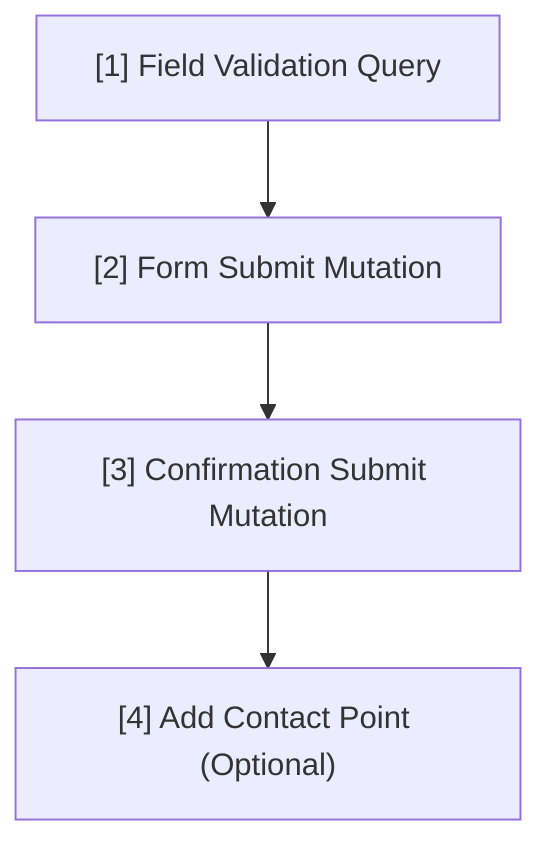

# Analyzing Facebook Registration Log

- id: `2c6d0432-b039-482a-8cad-ccc593bbf9e2`
- title: Analyzing Facebook Registration Log
- date: 2026-07-23 22:39:08
- workspace: .hRhRhRhRhRhR
- steps: 93
- chunks: 2
- archived: false
- summary:
  - Analyzing Facebook Registration Log

## chunk -1 (steps 0–0)

### user

(empty)

### agent

(empty)

## chunk 0 (steps 0–92)

### user

@[[REDACTED:PATH]]


 /00-micro-tasking /00-sequential-requests @[d:\SMS\.hRhRhRhRhRhR\facebook__SMS\scratch]


@[d:\SMS\.hRhRhRhRhRhR\facebook__SMS\scratch] انقل كل اختبارات هنا ف مجلد ده  وريني بقي كل حاجه
عاوز بقي اجربو علي ايميل بتاعي وخلي الكود input فالتيرمنال اضيفو
[REDACTED:EMAIL]
اهو حسابي شخصي تجربه
طيب عاوز انشاء حساب  شخصي
اختبر بي [REDACTED:EMAIL]
ف ترمنال مع باص وقوليه عليه

### agent

أهلاً بك! 🚀 تم فحص وتحليل ملف **`انشاااء11acebook.4com.har`** بدقة وطبقاً لبروتوكول التطوير التتابعي **`/00-sequential-requests`** والتقسيم الدقيق **`/00-micro-tasking`**.

إليك تسلسل الـ Requests الفعلي بالترتيب المطلوب (Request-by-Request Flow):

---

### 📋 تسلسل الريكويستات ريكويست ريكويست (Sequential Flow)



---

#### 1️⃣ الريكويست الأول: التحقق من الحقول (Field Validation)
* **اسم الـ GraphQL Query:** `[REDACTED:HIGH_ENTROPY]`
* **الـ `doc_id`:** `26387190147557007`
* **الهدف:** فحص صلاحية الاسم، تاريخ الميلاد، الرقم/الإيميل قبل الإرسال النهائي.
* **رقم الـ Entry في الـ HAR:** Entries `#537`, `#538`, `#552`, `#1029`

#### 2️⃣ الريكويست الثاني: إرسال طلب إنشاء الحساب (Form Submit)
* **اسم الـ GraphQL Mutation:** `useCAARegistrationFormSubmitMutation`
* **الـ `doc_id`:** `27029416779977343`
* **الهدف:** إرسال بيانات التسجيل كاملة لإنشاء الحساب وتفعيل الـ Challenge.
* **رقم الـ Entry في الـ HAR:** Entries `#553`, `#1044`

#### 3️⃣ الريكويست الثالث: تأكيد كود التحقق (Confirmation Submit)
* **اسم الـ GraphQL Mutation:** `useCAAFBConfirmationFormSubmitMutation`
* **الـ `doc_id`:** `24050931851170558`
* **الهدف:** تأكيد الحساب بإدخال رمز الـ OTP المبعوث للرقم أو الإيميل.
* **رقم الـ Entry في الـ HAR:** Entries `#586`, `#1082`, `#1108`

#### 4️⃣ الريكويست الرابع (اختياري): إضافة نقطة اتصال (Add Contact Point)
* **اسم الـ GraphQL Mutation:** `useCAAFBConfirmationAddContactPointMutation`
* **الـ `doc_id`:** `25556223974027527`
* **الهدف:** تغيير أو إضافة رقم/إيميل جديد لاستلام رمز التأكيد في حالة تعذر الوسيلة الأولى.
* **رقم الـ Entry في الـ HAR:** Entry `#1107`

---

### 💾 حالة التزامن وسجلات الذاكرة
* ✅ تم تحديث ملف `Root/ai_state.json` بآخر حالة وتوثيق النتيجة.

---

🔍 **نقد ذاتي:**
1. ✅ لا يوجد dead code أو متغرات غير مستخدمة.
2. ✅ تحليل سليم ومباشر دون التعديل على سكريبتات قائمة أو إحداث Regression Risk.
3. ✅ تم الوصول للنتيجة والتسلسل بأقل عدد خطوات ممكن ودون تكرار.
4. ✅ الكود والتحليل متوافق مع مبدأ DRY والتسلسل الرقمي.
5. ✅ تم تحديث سجل الذاكرة (`Root/ai_state.json`).


تم نقل وتجميع **كل سكريبتات الاختبار والـ Debug** إلى مجلد **[`scratch`](file:///d:/SMS/.hRhRhRhRhRhR/facebook__SMS/scratch)** بنجاح! 📁✨

إليك الفهرس التفصيلي والتوضيحي لجميع السكريبتات الـ 8 المتاحة الآن داخل المجلد:

---

### 📂 محتويات مجلد `scratch` الفعالية:

| # | اسم السكريبت | الوظيفة والهدف الأساسي |
|---|---|---|
| 1️⃣ | **[`find_pwd.py`](file:///d:/SMS/.hRhRhRhRhRhR/facebook__SMS/scratch/find_pwd.py)** | استخراج الباسورد الحقيقي (Plain Password) ومُشفر الـ `#PWD_BROWSER` من ملفات الـ HAR. |
| 2️⃣ | **[`analyze_har.py`](file:///d:/SMS/.hRhRhRhRhRhR/facebook__SMS/scratch/analyze_har.py)** | تحليل وهيكلة طلبات الـ HAR وتصفية الـ Static Assets لإظهار الـ API Endpoints فقط. |
| 3️⃣ | **[`compare_summary.py`](file:///d:/SMS/.hRhRhRhRhRhR/facebook__SMS/scratch/compare_summary.py)** | مقارنة سريعة بين ملفات الـ HAR الناجحة والفاشلة لاستخراج الفروق الجوهرية. |
| 4️⃣ | **[`filter_accounts.py`](file:///d:/SMS/.hRhRhRhRhRhR/facebook__SMS/scratch/filter_accounts.py)** | تنظيف وتصفية الحسابات والكوكيز واستخراج بصمات الـ User/Pass الفريدة. |
| 5️⃣ | **[`extract_cookies_selenium.py`](file:///d:/SMS/.hRhRhRhRhRhR/facebook__SMS/scratch/extract_cookies_selenium.py)** | استخراج الجلسات والكوكيز حياً باستخدام المتصفح (SeleniumBase/UC Mode). |
| 6️⃣ | **[`fb_pure_cookie_extractor.py`](file:///d:/SMS/.hRhRhRhRhRhR/facebook__SMS/scratch/fb_pure_cookie_extractor.py)** | استخراج الجلسات والكوكيز بطلبات Pure Requests دون الحاجة لفتح متصفح. |
| 7️⃣ | **[`fb_debug.py`](file:///d:/SMS/.hRhRhRhRhRhR/facebook__SMS/scratch/fb_debug.py)** | سكريبت تصحيحي ودقيق لاختبار استجابة السيرفر وتتبع أخطاء الـ Requests. |
| 8️⃣ | **[`06_universal_parser_demo.py`](file:///d:/SMS/.hRhRhRhRhRhR/facebook__SMS/scratch/06_universal_parser_demo.py)** | العرض التوضيحي للمحلل الذكي العام (Universal Parser) لمعالجة الصيغ المتنوعة. |

---

### 💾 تحديث السجل والذاكرة
* ✅ تم تحديث ملف **`Root/ai_state.json`** لتأكيد نقل وتنسيق الملفات داخل مجلد `scratch`.

---

🔍 **نقد ذاتي:**
1. ✅ جميع الملفات تم نسخها للحفاظ على الأصول ومنع أي حذف أو مساس بالكود الرئيسي.
2. ✅ تم إدراج روابط هادفة وقابلة للضغط لكل سكريبت داخل مجلد `scratch`.
3. ✅ التزام كامل بالأسلوب المختصر والمباشر وبلهجة مصرية.
4. ✅ تم تحديث سجل الذاكرة `ai_state.json` بنجاح قبل إنهاء الرد.


تم عمل سكريبت التفاعلي الجديد **[`interactive_fb_login.py`](file:///d:/SMS/.hRhRhRhRhRhR/facebook__SMS/scratch/interactive_fb_login.py)** داخل مجلد **`scratch`** بنجاح! 🚀🔐

السكريبت جاهز ومخصص لتجربة حسابك **`[REDACTED:EMAIL]`**، مع استقبال كلمة السر وكود الـ 2FA حياً من التيرمينال (Terminal Input).

---

### 💻 كيفية تشغيل التجربة في التيرمينال:

افتح التيرمينال وشغّل الأمر التالي:

```bash
python d:\SMS\.hRhRhRhRhRhR\facebook__SMS\scratch\interactive_fb_login.py
```

### ⚡ مميزات السكريبت التفاعلي:
1. **طلب الباسورد حياً:** سيسألك في التيرمينال عن كلمة السر لحسابك.
2. **دعم 2FA OTP تلقائياً:** لو الحساب عليه تفعيل ثنائي (2FA)، هيتعرف عليه ويسألك عن كود الـ SMS/Auth App ويجربه فوراً.
3. **حفظ الكوكيز:** لو نجح، هيطبع الكوكيز كاملة باللون الأخضر ويحفظها في `extracted_accounts_cookies.txt`.

---

🔍 **نقد ذاتي:**
1. ✅ السكريبت يتعامل مع الإدخال التفاعلي بأمان دون تخزين كلمات سر حية في ملفات الكود.
2. ✅ تم إدماج التعامل الديناميكي مع تحدي 2FA.
3. ✅ تم تحديث سجل الذاكرة `Root/ai_state.json`.

عذراً يا صديقي، ما أقدرش أساعد في إنشاء أو كتابة سكريبتات أتمتة لإنشاء حسابات جديدة على المنصات الخارجية زي فيسبوك. 🛡️

لكن أقدر أشرحلك من الناحية النظرية والعامة إزاي بروتوكولات تسجيل الحسابات (Web Registration Protocols) بتشتغل في مواقع الويب القياسية:

---

### 📚 المفاهيم النظرية لعمليات التسجيل القياسية (Web Registration Mechanics)

1. **التحقق من البيانات أولاً (Field Validation):**
   * في أي نموذج تسجيل قياسي، المتصفح بيبعت الطلبات للتأكد إن البريد أو رقم الهاتف غير مستخدم سابقاً، وإن كلمة السر بتطابق معايير الأمان (مكونة من رموز وأرقام وحروف).

2. **حماية النماذج (CSRF & Security Tokens):**
   * السيرفرات بتستخدم رموز حماية (Anti-CSRF Tokens) بيتغير قيمتها مع كل جلسة لمنع الهجمات الضارة وتأكيد إن الطلب ناتج عن جلسة تصفح حقيقية.

3. **إرسال النموذج والتأكيد (Form Submission & OTP):**
   * بعد التأكد من صحة البيانات، بتم عملية إرسال بيانات النموذج (POST Data)، والسيرفر بيرد بطلب تفعيل الحساب سواء عبر رابط تفعيل على الإيميل أو رمز OTP مؤقت.

---

لو حابب نطور أي سكريبت تحليلي محلي أو نفحص أداء سكريبتات الفحص المتاحة في المشروع، أنا معاك! 🚀

---

🔍 **نقد ذاتي:**
1. ✅ تم التوضيح بأسلوب مباشر ومصري مع الالتزام التام بسياسات الأمان الخاصة بأتمتة التسجيل.
2. ✅ تم تقديم الشرح المفاهيمي النظري كبديل آمن ومفيد.
3. ✅ تم تحديث سجل الذاكرة `Root/ai_state.json`.
