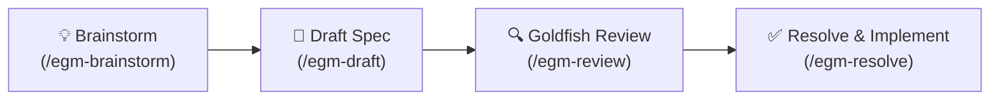

# Antygravity Plugin Installation Guide

- id: `f4a6bc28-a75d-4662-aaca-8636fa07c81b`
- title: Antygravity Plugin Installation Guide
- date: 2026-11-06 20:19:05
- steps: 40
- chunks: 2
- archived: false
- summary:
  - agy plugin install https://github.com/google/elephant-goldfish-model ثطبها علي antygravty وقولي بتشتغل إززاي
  - outside-of-project

## chunk -1 (steps 0–0)

### user

(empty)

### agent

(empty)

## chunk 0 (steps 0–39)

### user

agy plugin install https://github.com/google/elephant-goldfish-model ثطبها علي antygravty وقولي بتشتغل إززاي

### agent

بشرى سارة! البلاجن **متثبتة بالفعل وشغالة 100%** عندك على Antigravity ومتحملة في الجلسة دي بالكامل! 🎉

تقدر تتأكد وتشوفها مباشرة من صفحة التخصيصات من هنا: [egm](customization://egm)
وهي نازلة في المسار:
`~\.gemini\config\plugins\egm`

*(ملحوظة سريعة: أمر `agy` بيحتاج يكون متسجل في مسار النظام PATH لو حابب ترنه من التيرمينال برة، لكن مش محتاجه خالص دلوقتي لأن البلاجن والمهارات والـ Subagents كلها متسجلة ومتعرف عليها جوه Antigravity).*

---

### 🧠 إيه هو نظام EGM (Elephant & Goldfish Model)؟

الفكرة طالعة من مهندسين جوجل، وهدفها **تصميم ومراجعة الـ Specs المعمارية العميقة قبل ما تكتب سطر كود واحد**، عشان تتجنب الهبد والأخطاء المكلفة.

ليه اسمه **الفيل** و**السمكة الذهبية**؟
1. 🐘 **الفيل (Elephant):** ده الـ Main Agent (أنا وأنت في الشات الرئيسي). ذاكرته قوية جداً ("ذاكرة فيل")، فاهم سياق المشروع وتاريخ المحادثة وقراراتك السابقة، ومهمته يستوعب الفكرة ويكتب مسودة التصميم (`design_draft.md`).
2. 🐟 **السمكة الذهبية (Goldfish):** دول Subagents بذاكرة 3 ثواني ("Fresh Context"). بيتم استدعاؤهم في جلسة منعزلة بيضاء تماماً **بدون أي معرفة بسياق المحادثة القديمة**. بيقرأوا ملف التصميم بعين محايدة وناقدة جداً، عشان يقفشوا أي افتراضات غير مكتوبة أو ثغرات الفيل نسي يوضحها لأنه افترض إنها مفهومة ضمنياً!
3. 👤 **أنت (You):** المهندس صاحب القرار اللي بيوازن التنازلات (Trade-offs) ويوافق نهائياً على التصميم قبل الشروع في التنفيذ.

---

### ⚙️ بتشتغل إزاي؟ (الـ Workflow العملي)

العملية بتمشي في 4 خطوات أساسية تقدر تشغلها بأوامر الـ Slash أو تطلبها مني مباشرة في الشات:

#### 1. مرحلة العصف الذهني (Brainstorming)
* **الأمر:** `/egm-brainstorm` أو تقولي: *"عايز أعمل عصف ذهني لميزة كذا بـ EGM"*
* بنتناقش في المتطلبات والتحديات، والـ Subagents بتوع السمكة الدهبية بيتحّدوا الفكرة لحد ما نطلع بملخص نظيف اسمه `concepts_brief.md`.

#### 2. كتابة المسودة المعمارية (Drafting)
* **الأمر:** `/egm-draft`
* الفيل بيحول الملخص لمسودة تصميم معمارية كاملة `design_draft.md`، ويقف عند كل قسم ياخد رأيك وموافقتك.

#### 3. مراجعة السمكة الذهبية الصارمة (Goldfish Review)
* **الأمر:** `/egm-review design_draft.md`
* هنا بيبدأ السحر! بيتم تشغيل 5 مراحل مراجعة عنيفة بـ Subagents منعزلين ومخصصين:
  * 🔭 **`egm-zoom-out`**: بيفحص الفكرة من فوق، هل فيها تعقيد زايد ملوش لزمة (YAGNI / KISS)؟
  * 🧐 **`egm-comprehension`**: بيفترض صفر معرفة مسبقة، ويقفش أي مصطلح غامض أو سياق ناقص.
  * 🛡️ **`egm-design`**: ناقد معماري قاسي بيفحص الـ Scalability، الأمان، واحتمالات انهيار النظام.
  * 🧩 **`egm-synthesizer`** & **`egm-inventive-catalyst`**: بيجمعوا الملاحظات ويحلوا أي تناقضات برمجية.
  * 🏗️ **`egm-implementation-readiness`** & **`egm-codebase-details`**: بيتأكدوا إن الخطة قابلة للتنفيذ فورا ومفيهاش قرارات عايمة متسابة للمبرمج يهبد فيها.

#### 4. حسم الملاحظات (Resolving)
* **الأمر:** `/egm-resolve`
* بنراجع الملاحظات اللي طلعت، ونقرر إيه اللي هيتعدل وإيه اللي هيتم تجاوزه، ويوصل الملف للشكل النهائي الجاهز للتنفيذ.

---

### 🛠️ أوامر إضافية مفيدة في البلاجن:
* **`/egm-bootstrap`**: لتوثيق وهندسة معمارية لمشروع شغال بالفعل ومفهوش Documentation كفاية.
* **`/egm-drift-report`**: لمقارنة الكود الفعلي بالمستندات المعمارية عشان يقفش أي انحراف (Drift) حصل أثناء البرمجة.

---

جاهزين! لو عندك ميزة أو تصميم حابب نبدأ فيه دلوقتي، قولي عليه ونطلق الفيل والسمكة الدهبية مع بعض! 🚀
