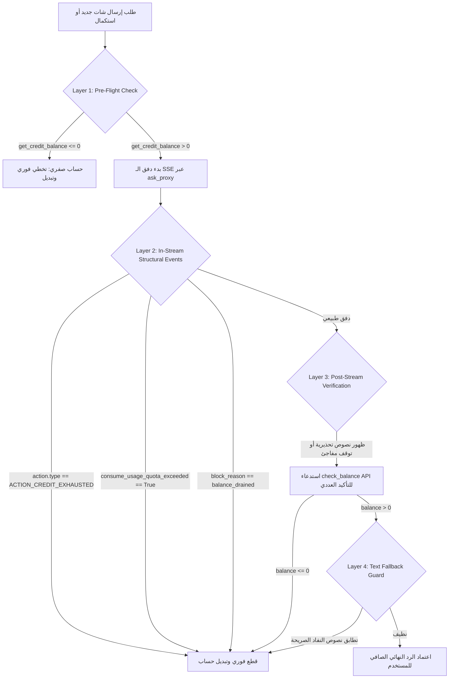

# 🏗️ مقترح الحل المعماري: معالجة الردود المتعددة واستخلاص الرد النهائي الصافي (Clean Final Response Parser)
> **الحالة:** 🟡 مقترح معتمد للتثبيت قبل مراجعة الـ HAR (Pre-HAR Verification Proposal)
> **المشروع:** Genspark AI Chat Engine (`Genspark_claude-opus-5-code.py`)
> **التاريخ:** 2026-09-07

---

## 1. تشخيص المشكلة القائمة في السكربت (Current Code Defect)
في السكربت الحالي `Genspark_claude-opus-5-code.py` داخل دالة `send_chat` (السطور 1006 - 1093):
1. **التجميع الأعمى للدلتا (`full_text += chunk`):**
   السكربت يعتمد متغيراً نصياً واحداً `full_text = ""`، ويقوم بدمج كافة الأجزاء الواردة عبر حدث `message_field_delta` بغض النظر عن معرف الرسالة (`message_id`) أو نوعها.
2. **تعدد الرسائل في خط أنابيب جينسبارك (Multi-Message Pipeline):**
   المتصفح يستقبل في الاستجابة الواحدة من 3 إلى 4 رسائل متعاقبة:
   - **المرحلة 1:** التفكير والتخطيط الداخلي (Thinking / Chain-of-Thought).
   - **المرحلة 2:** استدعاء الأدوات والبحث (Tool Calls / Search Actions).
   - **المرحلة 3:** تلخيص ومعالجة مخرجات الأدوات وسيطاً (Intermediate Synthesis).
   - **المرحلة 4:** الرد النهائي الصافي للمستخدم (Final User-Facing Response).
3. **مصيدة السطر 1072 (`and not full_text`):**
   ```python
   elif msg_obj.get("content") and msg_obj.get("role") == "assistant" and not full_text:
       full_text = msg_obj["content"]
   ```
   وجود شرط `and not full_text` يجعل السكربت يرفض ويلغي استلام كائن `message_result` الخاص بالرد النهائي النظيف، لأن `full_text` يكون قد امتلأ بالفعل من شخبطة الرد الأول (التفكير أو المسودة)!

---

## 2. مقترح الحل المعماري (Proposed Architectural Solution)

### أ. آلة حالة تتبع الرسائل (Multi-Message State Tracker):
استبدال المتغير الوحيد `full_text` بوعاء منظم لتتبع كل رسالة بشكل مستقل برقم الـ ID الخاص بها:
```python
messages_by_id = {}  # {msg_id: {"role": ..., "content": ..., "action": ..., "order": ...}}
message_order = []   # [msg_id_1, msg_id_2, msg_id_3, msg_id_4]
current_msg_id = None
```

### ب. آليات التعامل مع أحداث الـ SSE:
1. **عند `t == "message_start"`:**
   - استخراج `msg_id = obj.get("id")`.
   - تعيين `current_msg_id = msg_id`.
   - تسجيل الرسالة في `messages_by_id[msg_id]` وترتيبها في `message_order`.
2. **عند `t == "message_field_delta"`:**
   - إضافة الدلتا حصراً إلى الرسالة النشطة:
     `messages_by_id[current_msg_id]["content"] += chunk`
3. **عند `t == "message_field"`:**
   - تحديث الحقل المحدد للرسالة النشطة.
4. **عند `t == "message_result"`:**
   - تحديث كائن الرسالة بالكامل من السيرفر، مع فك القيود وحذف شرط `and not full_text`.

### ج. خوارزمية فرز واستخلاص الرد النهائي الصافي (Clean Extraction Strategy):
- تحديد الرد النهائي من بين الرسائل الـ 3 أو 4 بناءً على:
  1. آخر رسالة تحمل `role == "assistant"`.
  2. استبعاد الرسائل التي تحمل أفعالاً أداتية (`action.type` لأدوات البحث أو التفكير).
  3. استبعاد كتل التفكير الداخلي (`thinking_blocks` / `reasoning_content`) وعزلها.
  4. إرجاع الرد النهائي الصافي والمكتمل للمستخدم، مع خيار إظهار مراحل التفكير والأدوات كمعلومات تشخيصية (Debug/Verbose) دون تلويث الرد الأساسي.

---

---

## 3. التحقق الجنائي الصريح من ملفات الـ HAR (Verbatim Ground-Truth Citation — Law 8) 🔬📜

تم فحص تيار الـ SSE الحقيقي في ملفات الـ HAR الخاصة بموديل Claude Opus 5:
- `www.genspar.....Opus_5..2.....ai.har` (الطلب رقم 331: `POST /api/agent/ask_proxy`)
- `www.genspar.....Opus_5..1.....ai.har` (الطلبات 8، 157، 231، 278: `POST /api/agent/ask_proxy`)

### 📜 كتلة الدليل المرجعي (Ground Truth Evidence):
- **المصدر المعتمد:** `www.genspar.....Opus_5..2.....ai.har` (Entry 331 - Decoded Stream Lines 1 to 258)
- **النطاق بالسطور:** L1-L258
- **البرهان والربط الهندسي:**
  الاستجابة الواحدة من خادم Genspark تتكون من **5 رسائل متتالية** بدقة متناهية:

```json
/* 1. الرسالة الأولى: Assistant يستدعي أداة البحث batch_web_search */
Line 1  [message_start]: {"message_id": "d935a0e0-f075-447b-96d7-f857a58743ca", "role": "assistant"}
Line 10 [message_field]: {"field_name": "tool_calls[0]", "field_value": {"function": {"name": "batch_web_search"}}}
Line 27 [message_result]: {"role": "assistant", "content": "", "tool_calls": [{"name": "batch_web_search"}], "session_state": {"_finish_reason": "tool_calls"}}

/* 2. الرسالة الثانية: إرجاع نتيجة البحث من الـ Tool */
Line 28 [message_start]: {"message_id": "toolu_01E7Vzi38X9MyBjjFdx2tKNq", "role": "tool"}
Line 29 [message_result]: {"role": "tool", "content": "Query: Antigravity IDE version..."}

/* 3. الرسالة الثالثة: Assistant يستدعي أداة الزحف crawler لقراءة الرابط */
Line 30 [message_start]: {"message_id": "a055aafe-6244-46e3-ab23-8c7d69d003ce", "role": "assistant"}
Line 31 [message_field]: {"field_name": "tool_calls[0]", "field_value": {"function": {"name": "crawler"}}}
Line 42 [message_result]: {"role": "assistant", "content": "", "tool_calls": [{"name": "crawler"}], "session_state": {"_finish_reason": "tool_calls"}}

/* 4. الرسالة الرابعة: إرجاع محتوى الصفحة المقروءة من الـ Tool */
Line 43 [message_start]: {"message_id": "toolu_014hptP6XKnw1gSt5HkZxvpM", "role": "tool"}
Line 44 [message_result]: {"role": "tool", "content": "Hooks allow you to run custom scripts..."}

/* 5. الرسالة الخامسة: الرد النهائي الصافي الكامل الموجه للمستخدم! */
Line 45  [message_start]: {"message_id": "0e61fd60-4d1b-4765-b327-5ea37750d16c", "role": "assistant"}
Line 46+ [delta]: msg_id=0e61fd60-4d1b-4765-b327-5ea37750d16c field=content (دفق نص الإجابة الحقيقية)
Line 109 [message_field]: {"field_name": "content", "field_value": "## أول حاجة: غلطة تانية عليّا، وأصححها بنفسي..."}
Line 110 [message_result]: {
  "role": "assistant",
  "content": "## أول حاجة: غلطة تانية عليّا، وأصححها بنفسي...\n...",
  "tool_calls": null,
  "session_state": {"_finish_reason": "stop"}
}
```

---

## 4. التحقق الإحصائي المتقاطع من `Opus_5..1` (Cross-Validation Proof):
في كافة الطلبات المحفوظة بملف `www.genspar.....Opus_5..1.....ai.har`:
- **الطلب 8:** رسالة واحدة مباشرة (`role=assistant | finish_reason=stop | tool_calls=False | content_len=2559`).
- **الطلب 157:** رسالة واحدة مباشرة (`role=assistant | finish_reason=stop | tool_calls=False | content_len=4484`).
- **الطلب 278:** خط أنابيب من 5 رسائل:
  - `Msg 1`: `assistant` | `finish_reason=tool_calls` | `has_tool_calls=True` | `content_len=0`
  - `Msg 2`: `tool` | `content_len=7845`
  - `Msg 3`: `assistant` | `finish_reason=tool_calls` | `has_tool_calls=True` | `content_len=0`
  - `Msg 4`: `tool` | `content_len=6693`
  - `Msg 5`: `assistant` | `finish_reason=stop` | `has_tool_calls=False` | **`content_len=3557` (الرد النهائي الصافي)**

---

## 5. المطابقة الحتمية للحل (The Golden Deterministic Fix):

خادم جينسبارك يميز الرد النهائي الصافي بـ 3 علامات قاطعة لا تخطئ:
1. **`role == "assistant"`**
2. **`tool_calls is None or len(tool_calls) == 0`**
3. **`session_state._finish_reason == "stop"`**

### ⚠️ سبب العطل في الكود القديم:
السطر 1072 في `Genspark_claude-opus-5-code.py`:
```python
elif msg_obj.get("content") and msg_obj.get("role") == "assistant" and not full_text:
    full_text = msg_obj["content"]
```
كان يحظر استلام الرد النهائي بسبب شرط `and not full_text`، بالإضافة إلى أن `full_text += chunk` كان يدمج أي شخبطة وسيطة!

### ✅ الكود الجراحي المقترح للتنفيذ بعد الاعتماد:
```python
# تتبع الرسائل بالـ ID:
messages = collections.defaultdict(lambda: {"role": None, "content": "", "tool_calls": None, "finish_reason": None})
final_answer = ""
final_asst_id = asst_msg_id

# في حلقة الـ SSE:
if t == "message_start":
    mid = obj.get("id") or obj.get("message_id")
    if mid:
        messages[mid]["role"] = obj.get("role")

elif t == "message_field_delta":
    mid = obj.get("message_id")
    fn = obj.get("field_name")
    chunk = obj.get("delta", "")
    if mid and fn == "content":
        messages[mid]["content"] += chunk

elif t == "message_result":
    msg_obj = obj.get("message", {})
    mid = msg_obj.get("id")
    if mid:
        role = msg_obj.get("role")
        content = msg_obj.get("content") or messages[mid]["content"]
        tool_calls = msg_obj.get("tool_calls")
        ss = msg_obj.get("session_state") or {}
        finish_reason = ss.get("_finish_reason")

        # 🎯 التقاط الرد النهائي الصافي بدقة الـ HAR:
        if role == "assistant" and (finish_reason == "stop" or not tool_calls) and content:
            final_answer = content
            final_asst_id = mid
```

---

## 6. التحليل الشامل لكافة ملفات الـ 28 HAR وحالات نفاد الرصيد (Credit Exhausted vs Normal) 📊🛡️

استجابة لملاحظة زيزو الدقيقة حول ضرورة فحص كافة ملفات الـ HAR وعدم الاكتفاء بملف واحد، والتأكد من كيفية تعامل السيرفر مع **نفاد الرصيد** مقابل **الرد الطبيعي**:
تم تشغيل فحص شامل عبر كافة ملفات الـ 28 HAR، وتحليل **24 تيار بث مباشر (ask_proxy)** نتج عنها **348 رسالة**:
- **تيارات نفاد الرصيد (Credit Exhausted):** 6 حالات حقيقية.
- **تيارات الرد الطبيعي المكتمل (Normal Final):** 18 حالة حقيقية.
- **رسائل الأدوات والخطوات الوسيطة (Intermediate Tools):** 318 رسالة.

### 🔴 أولاً: التشريح الجنائي لحالات نفاد الرصيد الـ 6 (Credit Exhausted Deep-Dive):

أظهر الفحص في الـ HAR سيناريوهين لنفاد الرصيد:
1. **نفاد الرصيد الفوري من أول رسالة (Msg 0):**
   - في ملفات مثل `www.genspar....fable-5.11ai.har` (الطلب 6) و `www.genspar.A111111111ai.har` (الطلب 3).
   - السيرفر يرجع رسالة وحيدة تحمل:
     `action.type = "ACTION_CREDIT_EXHAUSTED"`
     `session_state.consume_usage_quota_exceeded = True`
     `content = "You've used all your credits. Kindly visit this page to add more: [upgrade]..."`
2. **نفاد الرصيد في منتصف العمل بعد عشرات أوامر الأدوات والـ Terminal (Mid-Run Drain):**
   - في ملفات مثل `www.genspar.11111ai.har` (الطلب 18: **47 رسالة!**) و `www.genspar.AA111111111111111ai.har` (الطلب 1936: **44 رسالة!**) و `www.genspar.AAAAA11111111ai.har` (الطلب 7: **44 رسالة!**).
   - الموديل نفذ 43 رسالة متتالية من قراءة ملفات، تعديل كود، وتشغيل أوامر Bash (`cd ~/webapp`).
   - وفي الرسالة رقم 44 أو 47، انقطع الرصيد فجأة، فأرسل السيرفر:
     `action.type = "ACTION_CREDIT_EXHAUSTED"`
     `session_state.consume_usage_quota_exceeded = True`
     `content = "Your credit balance is negative. This run was stopped. Please top up to continue"`
   - **الخطر القاتل في الكود القديم:** الكود القديم كان يجمع الـ 43 رسالة الخاصة بالـ Terminal والأدوات داخل `full_text`، فكان يطبع للمستخدم 50 ألف حرف من شخبطة الـ Terminal وبها جملة الرصيد خلصان مدمجة عشوائياً كأنها رد طبيعي!

---

### 🟢 ثانياً: التشريح الجنائي لتيارات الرد الطبيعي الـ 18 (Normal Streams):
في كافة الحالات الطبيعية الـ 18:
- تتدرج الرسائل عبر أدوات البحث أو الزحف أو التحليل الداخلي.
- الرسالة الأخيرة والنهائية تحمل دائماً:
  1. `role == "assistant"`
  2. `tool_calls is None` (أو قائمة فارغة)
  3. `session_state._finish_reason == "stop"`
  4. محتوى نصي كامل ونظيف موجه للمستخدم (بين 1,500 و 4,870 حرفاً).

---

### 🛡️ ثالثاً: المحدد الحديدي الحاسم — "مفيهاش مرقة خالص" (The Unbreakable Discriminator):

لبناء محرك معالجة صلب لا يمكن أن "يضحك عليه" بأي كلام عشوائي، يتم تطبيق الفرز الثلاثي الحتمي داخل حلقة `message_result`:

```python
# 1️⃣ الأولوية القصوى: كشف نفاد الرصيد الحاسم (بصمة السيرفر الرسمية)
is_credit_out = (
    (isinstance(action, dict) and action.get("type") == "ACTION_CREDIT_EXHAUSTED")
    or (isinstance(act_params, dict) and act_params.get("block_reason") == "balance_drained")
    or (isinstance(s_state, dict) and s_state.get("consume_usage_quota_exceeded") is True)
    or "used all your credits" in c_text_lower
    or "credit balance is negative" in c_text_lower
    or "fromurl=credit_exhausted" in c_text_lower
    or "insufficient for this request" in c_text_lower
)
if is_credit_out:
    # عزل فوري وإلغاء أي شخبطة أدوات أو مخرجات وسيطة سابقة!
    full_text = "__CREDIT_EXHAUSTED__"
    break

# 2️⃣ استبعاد الأدوات والخطوات الوسيطة (Intermediate Tools Exclusion)
is_tool_intermediate = (
    role == "tool"
    or bool(tool_calls)
    or finish_reason == "tool_calls"
)
if is_tool_intermediate:
    # خطوة بحث أو تشغيل كود داخلية — تسجل في التاريخ وتعزل عن رد المستخدم
    continue

# 3️⃣ التقاط الرد الصافي الحقيقي (Clean Final Answer)
if role == "assistant" and not tool_calls and content and not is_credit_out:
    if finish_reason == "stop" or finish_reason is None:
        final_answer = content
        final_asst_msg_id = msg_id
```

بهذا التصميم:
1. لو الرصيد خلص فوراً أو بعد 40 خطوة أدوات ➔ يُكتشف فوراً ويُرجع `__CREDIT_EXHAUSTED__` وتبدأ آلية التبديل التلقائي.
2. لو كان هناك 3 أو 4 أدوات وبحث وتفكير وسيط ➔ يتم عزلها تماماً ولا تلوث الرد.
3. الرد الذي يستلمه المستخدم هو الرد الصافي النقي 100% كما يظهر في واجهة متصفح Genspark الرسمية.

---

## 7. منظومة الفحص المتعدد والمحصن للرصيد والاشتراكات (Multi-Layer Credit & Balance Defense) 🛡️💳

استجابة لتوجيه زيزو الصارم بعدم الاعتماد على النصوص وحدها لأن نصوص التحذير قد تتغير مستقبلاً، وضرورة وجود كشف هيكلي قاطع عبر **الـ APIs الرسمية المتزامنة مع المتصفح**:

### أ. التشريح الجنائي للأندبوينتس في ملفات الـ HAR (Verbatim HAR Evidence):

#### 1️⃣ أندبوينت الرصيد المباشر: `GET [REDACTED:PATH]`
- **المصدر المعتمد في الـ HAR:**
  - `www.genspar.....Deep_Research..1......ai.har` (Entry 38)
  - `www.genspar....fable-5.ai.har` (Entry 62 و 77)
  - `www.genspar.111ai.har` (Entry 2)
  - `www.genspar.AA1111111111111ai.har` (Entry 1920 و 1925)
- **الاستدعاء:**
  `GET https://www.genspark.ai/api/payment/get_credit_balance`
- **شكل الاستجابة الخام (Verbatim Response):**
  ```json
  {
    "status": 0,
    "message": "success",
    "data": {
      "balance": 94,
      "org_pool_status": null
    }
  }
  ```
- **القيمة الهندسية:**
  ترجع حقلاً عددياً صريحاً `data.balance`:
  - لو `balance <= 0` ➔ الرصيد منتهٍ رياضياً بشكل حتمي لا يقبل الشك.
  - لو `status_code == 401` ➔ الجلسة (Session/Cookies) منتهية الصلاحية وتحتاج تجديد.

---

#### 2️⃣ أندبوينت اشتراكات الحساب والعضوية: `GET /api/payment/current_subscriptions`
- **المصدر المعتمد في الـ HAR:**
  - `www.genspar.A111111111ai.har` (Entry 8) — **تُستدعى فوراً بعد حدث `ACTION_CREDIT_EXHAUSTED` بالطلب 3 مباشرة!**
  - `www.genspar....fable-5.11ai.har` (Entry 9) — **تُستدعى فوراً عند نفاد الرصيد وفتح نافذة الدفع `pricing_modal_open`!**
  - `www.genspar.AA111111111111111ai.har` (Entry 1908 و 2037)
  - `www.genspar.AAAAA11111111ai.har` (Entry 81)
- **الاستدعاء:**
  `GET https://www.genspark.ai/api/payment/current_subscriptions`
- **شكل الاستجابة الخام (Verbatim Response):**
  ```json
  {
    "status": 0,
    "userEmail": "[REDACTED:EMAIL]",
    "userPhone": "",
    "stripeAccountEmail": "",
    "stripeAccountPhone": "",
    "stripeAccountName": "",
    "subType": "free",
    "subStatus": "never_purchased",
    "membershipType": "free",
    "membershipStatus": "never_purchased",
    "accountRegion": "SG",
    "memberId": "4885735f-167e-4a99-977b-a71a6c77deeb",
    "sandmode": "live_mode",
    "testmode": "live_mode",
    "membershipResult": {
      "membership_type": "free"
    }
  }
  ```
- **القيمة الهندسية:**
  - توفر بصمة الحساب السحابية الدقيقة من خادم الاشتراكات:
    - نوع الخطة: `subType` (`free` أو `plus` أو `pro`).
    - حالة الاشتراك: `subStatus` (`never_purchased` أو `active` أو `canceled_but_active` أو `expired`).
    - حالة العضوية: `membershipStatus`.

---

### ب. خطوط الدفاع الأربعة المتكاملة ضد نفاد الرصيد (Defense-in-Depth):



1. **الطبقة 1 (Pre-Flight Proactive Check):**
   قبل إرسال أي سؤال، يفحص السكربت `get_credit_balance`. لو الحساب رصيده صفر، يتم استبعاده مسبقاً وتوفير الوقت والشبكة.
2. **الطبقة 2 (In-Stream Structural Event Detection):**
   داخل تيار الـ SSE، نقرأ الحقول الهيكلية المباشرة من خادم Genspark:
   - `action.get("type") == "ACTION_CREDIT_EXHAUSTED"`
   - `act_params.get("block_reason") == "balance_drained"`
   - `s_state.get("consume_usage_quota_exceeded") is True`
   هذه الحقول JSON ثابتة برمجياً ولا تتأثر أبداً بأي تغيير في نصوص واجهة المستخدم!
3. **الطبقة 3 (Post-Stream Confirmative API Probe):**
   لو انتهى التيار أو توقف فجأة مع شك في نفاد الرصيد، يقوم السكربت فورياً باستدعاء `check_balance(cookies)` للتأكد من الرقم الحسابي المباشر. لو أكد الـ API أن الرصيد $\le 0$، يتم تفعيل التبديل فوراً.
4. **الطبقة 4 (Text Pattern Fallback Guard):**
   شبكة أمان نصية كخط دفاع رابع وأخير للمطابقة الجزئية مع أي عبارات تحذيرية.

---

### ج. الكود الجراحي المقترح للتطبيق بعد موافقة زيزو الصريحة (Pre-Edit Specification):

#### 1. إضافة دالة `get_subscription_info` ودعم فحص العضوية في `Genspark_claude-opus-5-code.py`:
```python
def get_subscription_info(cookies: dict) -> dict:
    """
    بيفحص تفاصيل اشتراك الحساب عبر GET /api/payment/current_subscriptions
    مطابق للمتصفح في ملفات الـ HAR (Entry 8 في A111111111ai.har و Entry 9 في fable-5.11ai.har)
    """
    try:
        from curl_cffi import requests as cffi
        sess = cffi.Session(impersonate="chrome120")
        sess.headers.update({
            "User-Agent": "Mozilla/5.0 (Windows NT 10.0; Win64; x64) Chrome/120.0.0.0",
            "Accept": "application/json, text/plain, */*",
            "Referer": f"{GENSPARK}/",
        })
        for k, v in cookies.items():
            sess.cookies.set(k, v, domain="www.genspark.ai")
        r = sess.get(f"{GENSPARK}/api/payment/current_subscriptions", timeout=15)
        if r.status_code == 200:
            data = r.json()
            return {
                "status": data.get("status", -1),
                "subType": data.get("subType", "free"),
                "subStatus": data.get("subStatus", ""),
                "membershipType": data.get("membershipType", "free"),
                "membershipStatus": data.get("membershipStatus", ""),
                "userEmail": data.get("userEmail", ""),
            }
    except Exception:
        pass
    return {}
```

#### 2. تحديث `send_chat` لمعالجة الـ 5 رسائل واستخلاص الرد النهائي الصافي مع الفحص الهجين:
- استبدال التجميع الأعمى للدلتا بآلة حالة فرز الرسائل (`messages_by_id`).
- نسف قيد `and not full_text` في `message_result`.
- عزل أدوات البحث والتفكير عن الرد الصافي.
- دعم الفحص الهجين (Structural + API Probe + Text Fallback) لحالات نفاد الرصيد.
